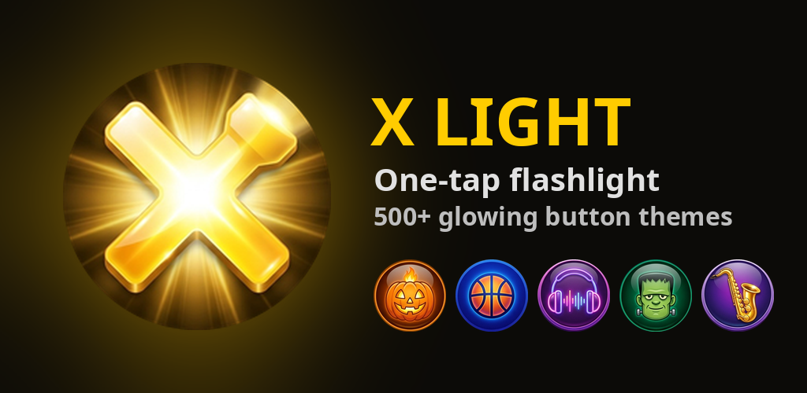
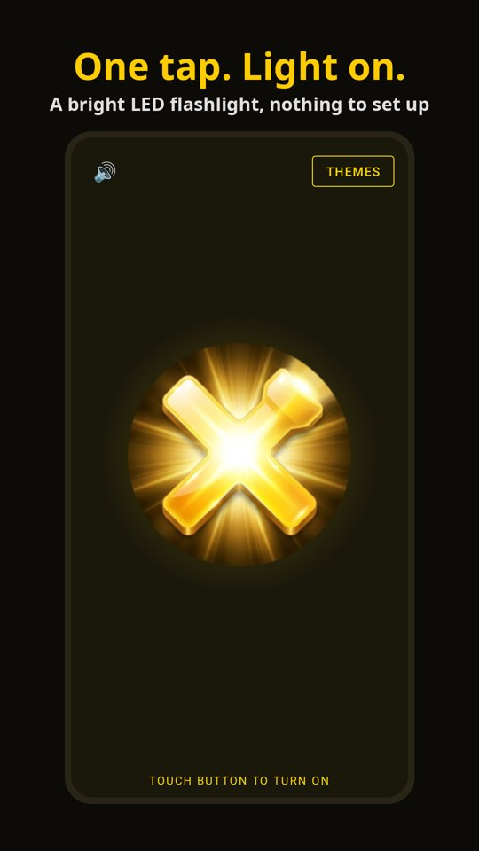
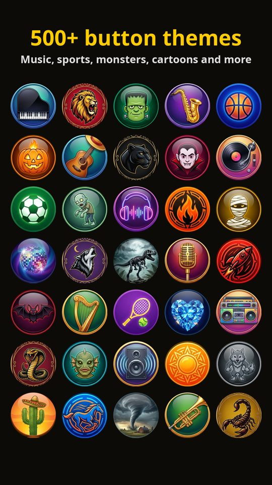
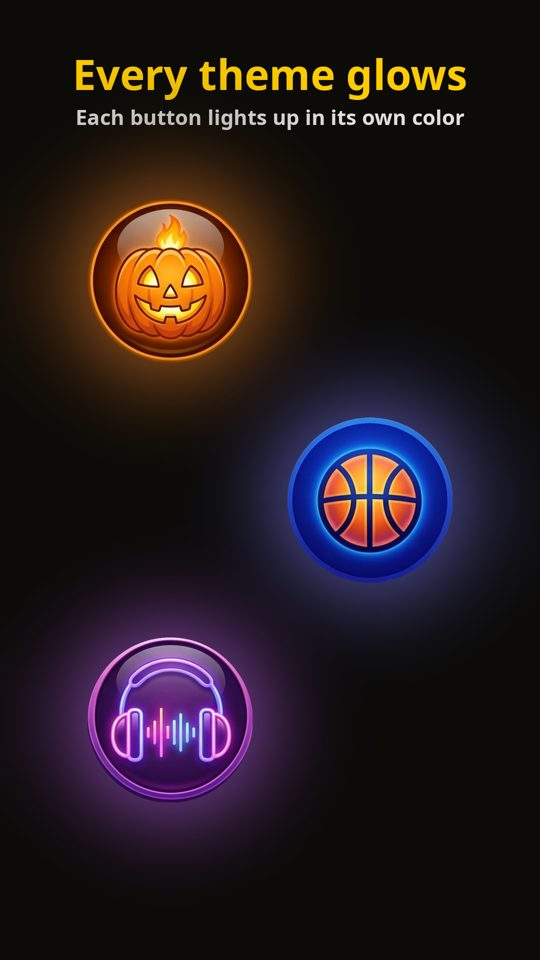
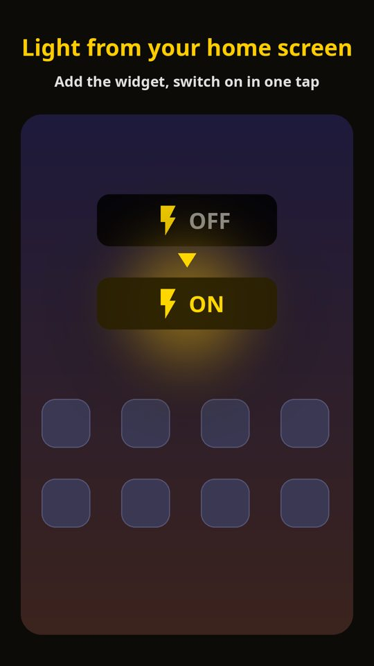
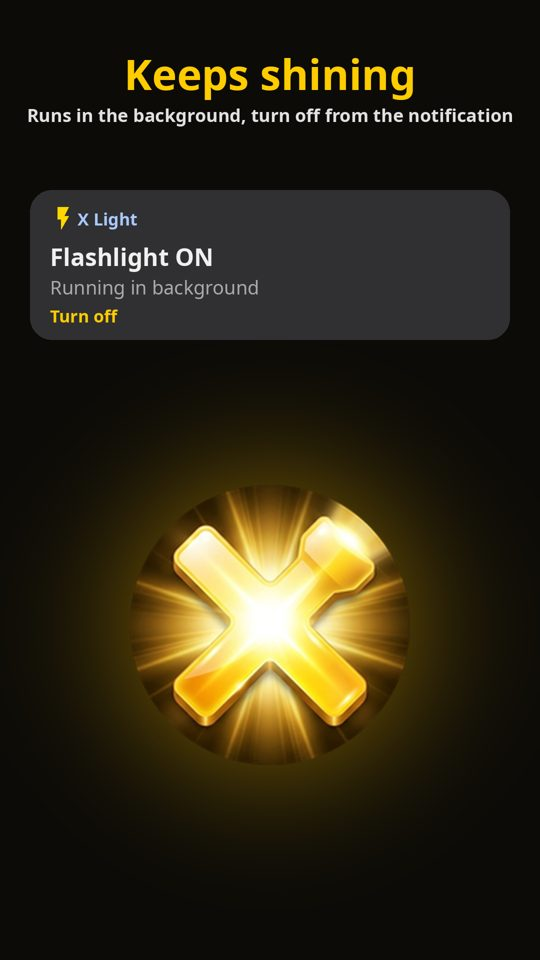
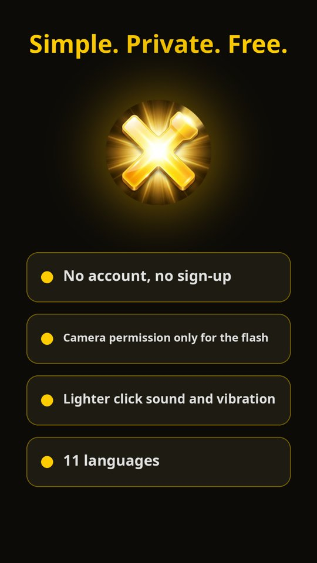

# 0xGollum — Android Apps

I build **Android apps you can actually make yours** — no forced defaults, no dead ends.

---

## 🔦 X Light — Flashlight & Torch

A bright LED flashlight that turns on in **one tap** — and looks like *you* want it to.
**500+ button themes** with matching glow colors, a **home-screen widget**, a torch that
**stays on in the background**, a lighter-style click with a short vibration, and **11 languages**.
Free, no account, no sign-up. The only permission is the camera — to control the flash.

  
  
  

  
  
  

**Live on Google Play** — handy for power cuts, finding your keys under the car seat,
a dark restaurant menu, the evening dog walk or camping. Honest feedback or a rating helps a lot.

---

## 🛠 Also by 0xGollum

- **Signal feeds on Apify** — 32 data actors → [github.com/0xGollum/Apify](https://github.com/0xGollum/Apify)
- Developer site → [0xgollum.github.io](https://0xgollum.github.io)

More Android apps coming soon.
