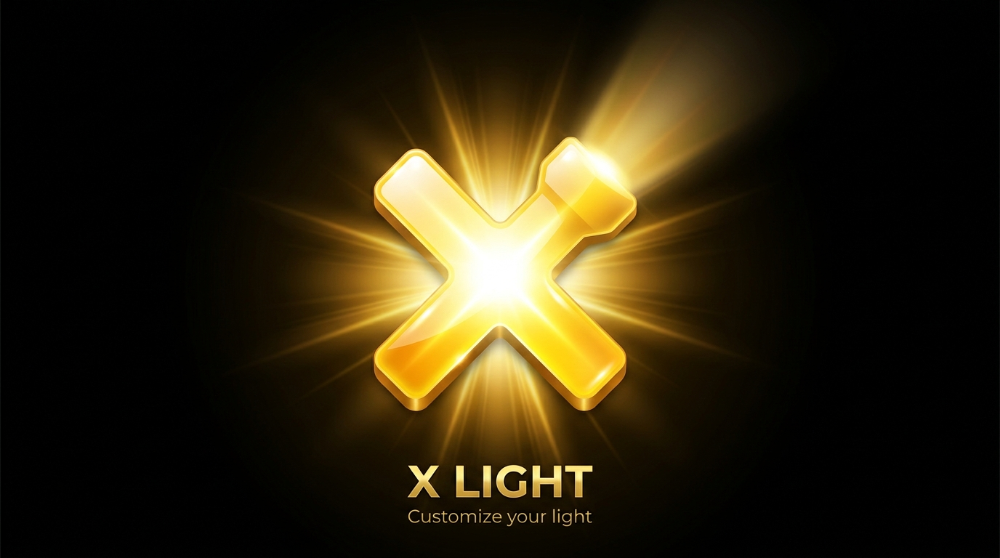
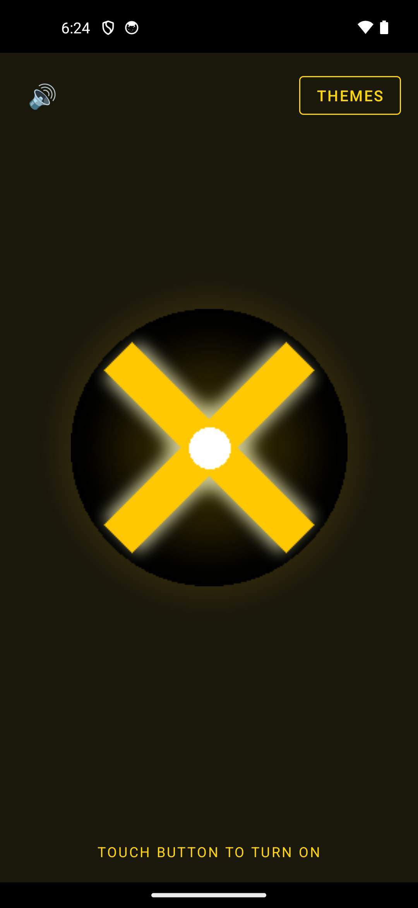
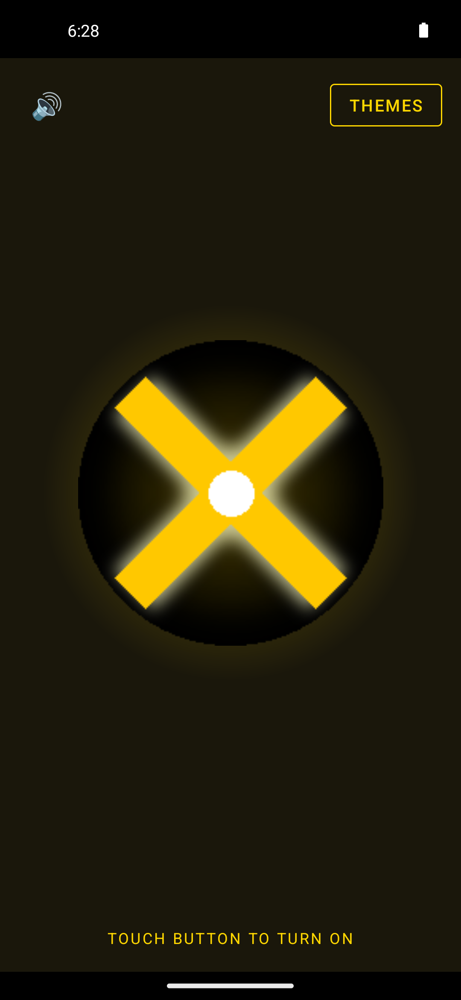
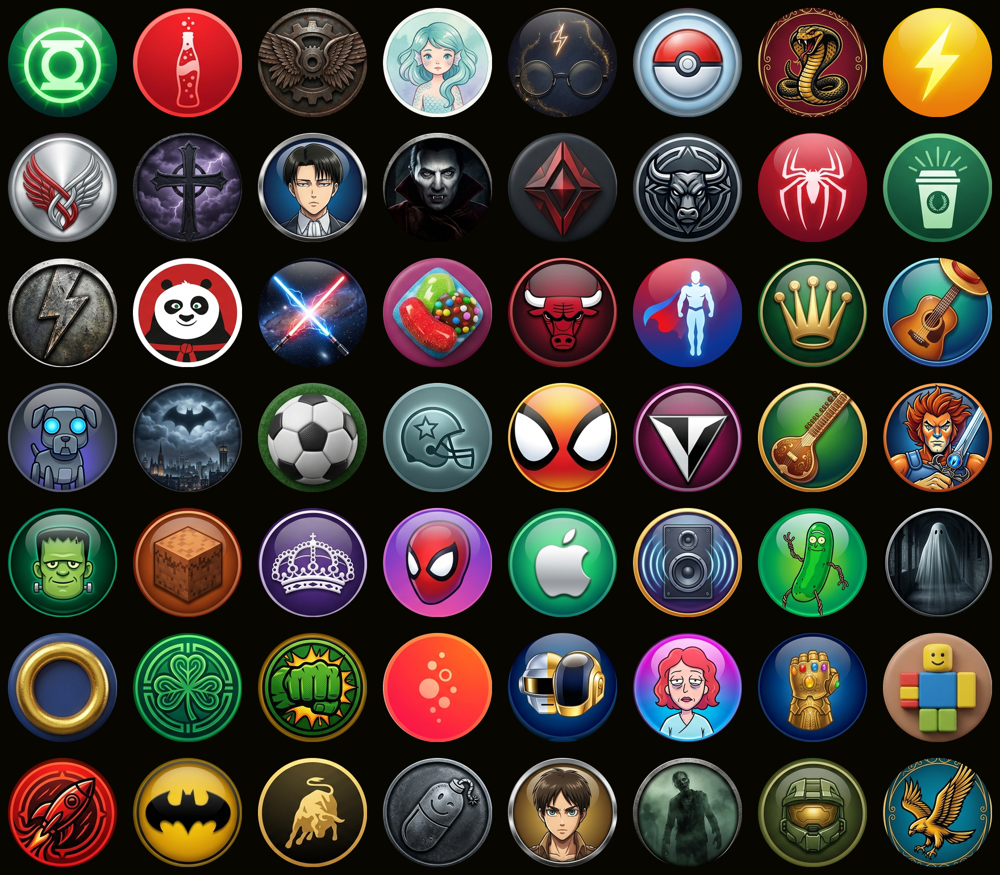

# 0xGollum — Android Apps

I build **Android apps you can actually make yours** — no forced defaults, no dead ends.

---

## 🔦 X Light — Customizable Flashlight

A flashlight app you can actually customize: **480+ unlockable themes** (icons, glow colors,
sounds), background-persistent torch, home screen widget. Free, ad-supported, no account needed.

  
  

**Now live on Google Play** — free, no account needed. Honest feedback or a rating helps a lot.

Developer site → [0xgollum.github.io](https://0xgollum.github.io)

---

More Android apps coming soon.
